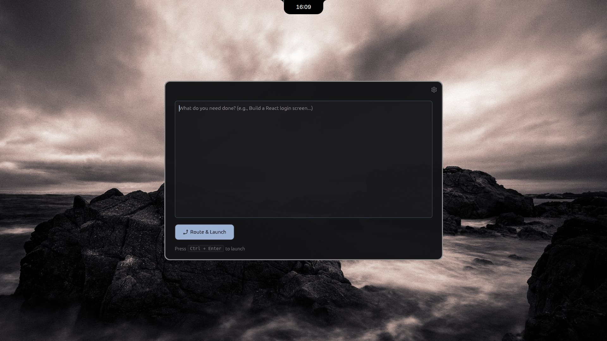

# rawter

**A tiny native Linux app: type a task, press <kbd>Ctrl</kbd>+<kbd>Enter</kbd>, and rawter sends it to the best AI tool for the job.**

<p align="center">
  
</p>

<p align="center">
  
</p>

---

## Why rawter?

You have a task — "Build a React login screen", "Summarize this PDF", "Generate a poster", "Refactor this repo".  
You don't want to decide *which* AI tool to use. You just want it done.

rawter classifies your task, scores 20 AI destinations against it, and launches the winner instantly.

---

## Features

| | |
|---|---|
| **20 destinations** | Claude, ChatGPT, Gemini, Grok, DeepSeek, Mistral, Perplexity, NotebookLM, v0, Bolt, Lovable, Replit, Cursor, Copilot, Midjourney, Runway, Suno, ElevenLabs, plus CLI (Claude Code) |
| **Smart routing** | 14-category classifier → weighted scoring → keyword overrides → confidence |
| **Two launch modes** | **URL** → opens in browser (`xdg-open`) · **CLI** → copies command to clipboard |
| **Keyboard-first** | <kbd>Ctrl</kbd>+<kbd>Enter</kbd> to launch · <kbd>Ctrl</kbd>+<kbd>,</kbd> settings · <kbd>Esc</kbd> cancel |
| **Confirm mode** | Optional: see the chosen destination, <kbd>Enter</kbd> confirms, <kbd>Tab</kbd> cycles alternatives |
| **History** | Last 50 tasks saved locally |
| **Pure Rust** | Built with `eframe`/`egui` (glow backend) — no Electron, no Tauri, no WebView, no JS runtime |
| **Single binary** | Ships as `rawter-x86_64.AppImage` (~8 MB), runs on any modern Linux |

---

## Install

### AppImage (recommended)
```bash
# Download latest release
wget https://github.com/<your-user>/rawter/releases/latest/download/rawter-x86_64.AppImage
chmod +x rawter-x86_64.AppImage
./rawter-x86_64.AppImage
```

### Build from source
```bash
git clone https://github.com/<your-user>/rawter.git
cd rawter
./build-appimage.sh   # produces rawter-x86_64.AppImage
```

**Requirements:** Linux x86_64, OpenGL (Mesa or vendor driver), X11 or Wayland session.

---

## Usage

1. **Launch rawter** — window opens (700×450, fixed, dark theme)
2. **Type your task** — e.g. `Build a React login screen with Tailwind`
3. **Press <kbd>Ctrl</kbd>+<kbd>Enter</kbd>** — rawter routes & launches
4. **Done** — browser opens (or CLI command lands in clipboard)

<details>
<summary>Keyboard shortcuts</summary>

| Key | Action |
|-----|--------|
| <kbd>Ctrl</kbd>+<kbd>Enter</kbd> | Launch (default) |
| <kbd>Enter</kbd> | Launch (if set in Settings) — <kbd>Shift</kbd>+<kbd>Enter</kbd> = newline |
| <kbd>Ctrl</kbd>+<kbd>,</kbd> | Open/close Settings |
| <kbd>Esc</kbd> | Close Settings / cancel confirm |
| <kbd>Enter</kbd> / <kbd>Tab</kbd> (confirm) | Confirm / next best destination |
</details>

---

## Settings (<kbd>Ctrl</kbd>+<kbd>,</kbd>)

| Section | What you control |
|---------|------------------|
| **Destinations** | Enable/disable each tool, choose URL vs CLI, edit deep-link template |
| **Routing** | Auto vs Keyword-only · Optimize for Quality/Speed/Cost · Confirm before launch · Fallback · Override rules (keyword → destination) |
| **Launch** | Launch key (<kbd>Ctrl</kbd>+<kbd>Enter</kbd> or <kbd>Enter</kbd>) · Clear input after launch |
| **History** | Keep history · Clear history |

Settings persist to `$XDG_CONFIG_HOME/rawter/settings.json` (or `~/.config/rawter/settings.json`).

---

## Routing Logic (from `router.rs`)

1. **Classify** — 14 categories (UI, app, code, agent, research, write, reason, docs, data, image, video, music, voice, chat) via weighted regex signals + structural boosts (code fences, stack traces, long text)
2. **Score** — For each enabled destination: weighted average of skills over active categories (weights squared), penalized for missing modal capabilities (image/video/music/voice), project-need mismatch, recency, long context; blended with speed/cost preference
3. **Decide** — User keyword rules first → if Auto mode & clarity ≥ 0.25: top score wins → else fallback (default: Claude)

**Acceptance tests (all passing):**

| Task | Expected | Confidence |
|------|----------|------------|
| Build a React login screen with Tailwind | v0 | 0.69 |
| Refactor the auth module across the repo and fix the failing tests | claude-code | 0.74 |
| What's the latest news on the EU AI Act? | perplexity | 0.54 |
| Draft a cover letter for a product manager role | claude | 0.73 |
| Generate a photorealistic poster of a lighthouse at dusk | midjourney | 0.97 |
| Summarize this PDF of meeting notes | notebooklm | 0.50 |
| Prove that the square root of 2 is irrational | claude | 0.36 |
| Make a lo-fi beat song about rainy mornings | suno | 0.96 |
| Build a SaaS app for invoicing with Stripe and auth | lovable | 0.51 |
| Write a Python function that parses ISO dates and add unit tests | claude | 0.59 |
| Compare Postgres vs MySQL for a small startup, with sources | perplexity | 0.55 |
| Make a 10 second video of waves crashing on a cliff | runway | 0.96 |
| Narrate this paragraph in a calm British voice | elevenlabs | 0.85 |
| Analyze this CSV of sales and plot revenue by month | chatgpt | 0.52 |
| hey / Why is the sky blue? | claude (fallback) | 0.30 |
| Build me a pricing page and a dashboard mockup | v0 | 0.69 |

---

## Project Structure

```
rawter/
├── Cargo.toml              # Rust 2021, eframe 0.36, egui 0.36
├── build-appimage.sh       # Produces rawter-x86_64.AppImage
├── packaging/rawter.desktop
├── .github/workflows/appimage.yml  # CI builds on Ubuntu 22.04
├── assets/
│   ├── rawter.png + sized variants
│   └── icons/ (settings, close, plus, trash, check, route, loader).svg
├── reference/
│   ├── router.js           # Source of truth for routing (ported to Rust)
│   └── RoutingLauncher.jsx # React reference UI
└── src/
    ├── main.rs       # Window, theme, app loop (~150 lines)
    ├── router.rs     # Catalog, classify, rank, route_task + tests (~480 lines)
    ├── settings.rs   # Settings model, load/save, merge catalog (~200 lines)
    ├── ui_main.rs    # Main screen, keyboard, status states (~320 lines)
    ├── ui_settings.rs# Settings screen (~240 lines)
    ├── icons.rs      # SVG loading + tinting (~60 lines)
    └── launch.rs     # Percent-encode, xdg-open, CLI escape, clipboard (~80 lines)
```

---

## Tech Stack

- **Language**: Rust 2021 edition
- **GUI**: `eframe` 0.36 / `egui` 0.36 (glow backend)
- **Routing**: Pure Rust port of the TypeScript reference algorithm
- **Serialization**: `serde` + `serde_json`
- **Regex**: `regex` crate (compiled once via `LazyLock`)
- **Icons**: Inline SVGs, `currentColor` → white at build, tinted at draw time via `egui_extras`
- **Packaging**: AppImage via `appimagetool`, CI on Ubuntu 22.04 (older glibc for broad compatibility)

---

## License

MIT — see [LICENSE](LICENSE) (add one if you need it).

---

## Credits

- Routing algorithm inspired by the reference TypeScript implementation
- UI icons: Lucide-style, stroke-only, `currentColor` (tinted at runtime)
- Built for developers who want their AI tool choice automated